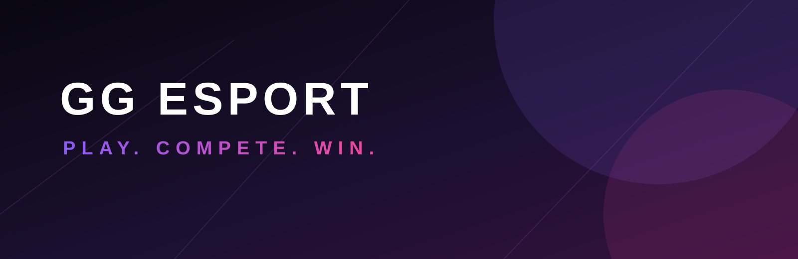

# GG ESPORT

> **PLAY. COMPETE. WIN.**

GG ESPORT is an Android-based Free Fire tournament and community platform. This public repository contains the project website, documentation, and links to the user APK distributed through GitHub Releases.

> GG ESPORT is an independent project. It is not affiliated with, sponsored by, or endorsed by Garena or Free Fire.

## About the project

The public release channel is designed to give players one trusted place to find the latest GG ESPORT Android build, installation guidance, tournament/community updates, and support links.

### Verified public experience

Because this repository does not include the private application source code, this list is limited to behavior and distribution surfaces verified from the repository and release metadata:

- Android user APK distribution through GitHub Releases.
- GG ESPORT WhatsApp Community and WhatsApp Channel access.
- Community announcements, tournament news, and match updates through the published channels.
- Official social and support links.

Tournament, wallet, account, match, notification, and other in-app capabilities are not documented here unless they are confirmed in a future public release note.

## Download

### [Download the latest GG ESPORT APK](https://github.com/GamingboyYTMI/GG-ESPORT/releases/latest)

The latest verified release is **v1.0.1**, published on GitHub with the `GG_Esports_User_v1.0.1.apk` user asset. Always use the dynamic latest-release page above rather than an outdated direct APK URL.

## Installation

1. Open the [latest release](https://github.com/GamingboyYTMI/GG-ESPORT/releases/latest).
2. Download the **User APK** from the release **Assets** section.
3. Open the downloaded APK on your Android device.
4. If Android asks for permission to install from that source, allow it temporarily for the browser or file manager you used.
5. Review the prompt and install the app.
6. Disable the temporary “install unknown apps” permission when you no longer need it.

See the detailed [installation guide](docs/INSTALLATION.md) for update and troubleshooting guidance. This project does not promise Google Play availability or verification.

## Screenshots

No verified app screenshots are currently included in this repository. Screenshots will be added only when authentic app captures are available; no mockups are presented as product screens.

## Community and support

- [WhatsApp Community](https://chat.whatsapp.com/EWhRMC2Pfi42BWvgRYxy92)
- [WhatsApp Channel](https://whatsapp.com/channel/0029Vb93OyKDuMRoQDclgW3V)
- [Instagram](https://www.instagram.com/gaming_boy534?exln=MWl3enNhY28wZjRpeg==)
- [YouTube](https://youtube.com/@gaming_boy)
- [Discord](https://discord.gg/9RsSm9Yf72)
- [Support email](mailto:gamingboylive46@gmail.com)

## Frequently asked questions

Read the complete [FAQ](docs/FAQ.md) for download, installation, update, and support answers.

## Version history

See [CHANGELOG.md](CHANGELOG.md) for the public release history.

## Privacy information

This repository does not contain the app source code or a verified privacy policy. Any permissions, data collection, retention, analytics, and third-party processing details still require confirmation from the project owner. See [docs/PRIVACY.md](docs/PRIVACY.md).

## Project status

This is currently a **binary distribution repository**. Private app source code, signing material, credentials, and backend configuration are intentionally not included.

## Contributing

Please read [CONTRIBUTING.md](CONTRIBUTING.md) before opening an issue or pull request. Never submit private application code, APK signing keys, service-account files, Firebase secrets, or other credentials.

## Disclaimer

GG ESPORT is an independent community project. Free Fire and Garena are trademarks of their respective owner. Do not redistribute modified APKs as official builds or present unofficial copies as GG ESPORT releases.

Copyright © 2026 GG ESPORT.
